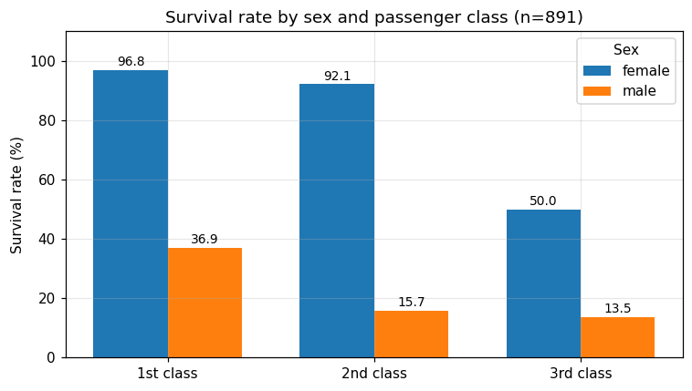
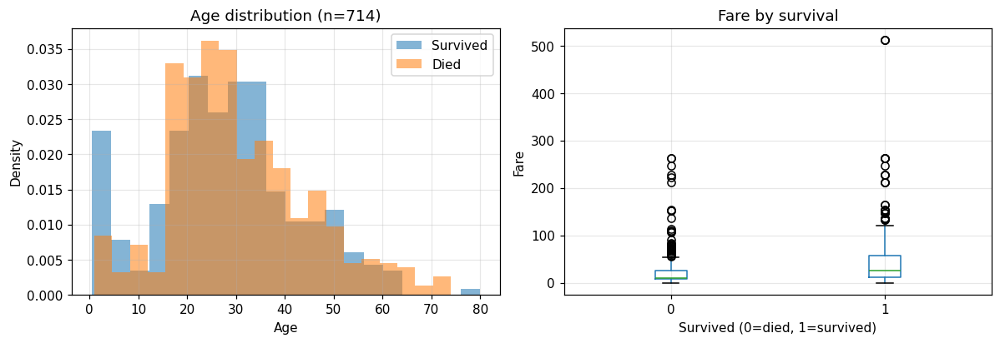
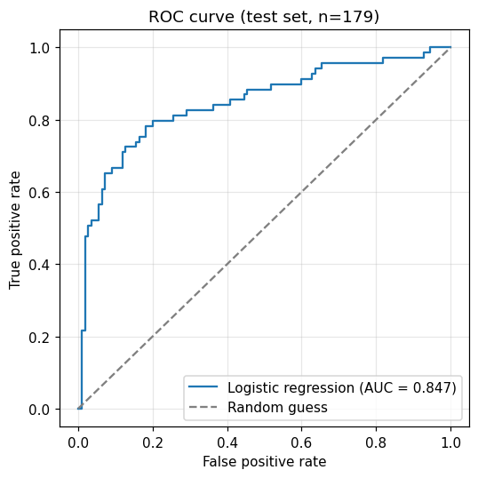

# 泰坦尼克号生存分析

> **一句话结论**：生还率主要由**性别**和**舱位**决定——女性生还率 74.2% 是男性 18.9% 的约 **4 倍**；头等舱 63.0% 是三等舱 24.2% 的 **2.6 倍**；卡方检验显示两个差异都高度显著（p < 1e-20）。控制年龄、票价、家庭规模后，男性生还的优势比仅 0.07（女性约为男性的 14 倍）。


📓 分析全过程在 [`notebooks/01_泰坦尼克生存分析.ipynb`](./notebooks/01_泰坦尼克生存分析.ipynb)，**在 GitHub 上直接点开就能看到全部输出和图表**。

---

## 1. 项目背景与研究问题

泰坦尼克号沉没时，救生艇按"妇女儿童优先"安排。但"优先"到底有多强？舱位（社会阶层）是否也在起作用？这些因素里哪个影响最大？

拆成三个递进的问题——这也是数据分析最常见的一条链路：

| 编号 | 研究问题 | 方法 |
|------|----------|------|
| Q1 | 性别、舱位、年龄与生还率的关系有多大？ | 描述统计 + 可视化 |
| Q2 | 这些差异是抽样波动，还是真的显著？ | 卡方检验 / t 检验 |
| Q3 | 控制其他变量后，每个因素的独立影响有多大？ | logistic 回归（优势比 OR） |

**动机**：走完一个完整的数据分析闭环——清洗 → 描述 → 检验 → 建模 → 解释，而不是"调个包看准确率"。

## 2. 数据

- **来源**：[Kaggle - Titanic: Machine Learning from Disaster](https://www.kaggle.com/competitions/titanic)
- **规模**：891 行 × 12 列（训练集）
- **文件**：`data/titanic.csv`（约 59 KB，已随仓库提交，clone 下来即可复现）

| 字段 | 含义 | 类型 | 缺失 |
|------|------|------|------|
| Survived | 是否生还（1=是，0=否） | int | 0 |
| Pclass | 舱位等级（1/2/3） | int | 0 |
| Sex | 性别 | str | 0 |
| Age | 年龄 | float | **177（19.9%）** |
| SibSp / Parch | 兄弟姐妹·配偶数 / 父母·子女数 | int | 0 |
| Fare | 票价 | float | 0 |
| Cabin | 舱位号 | str | **687（77.1%）** |
| Embarked | 登船港口（C/Q/S） | str | 2 |

**数据局限**：只包含已知生还情况的乘客（幸存者偏差）；`Cabin` 缺失 77% 不适合做主变量；历史观测数据，只能解释相关性，**不能下因果结论**。

## 3. 分析流程

一个 notebook，四个部分：

| 步骤 | 内容 | 关键产出 |
|------|------|----------|
| ① 数据概览 | 形状、类型、缺失率、目标分布 | 缺失率表、整体生还率 38.4% |
| ② 描述统计 + 可视化 | 性别/舱位交叉、年龄与票价分布 | 生还率对比图、年龄分布图 |
| ③ 假设检验 | 卡方检验 ×2、t 检验 | p 值与"显著≠重要"的解读 |
| ④ 建模 | logistic 回归、ROC/AUC、OR 与置信区间 | 准确率 81.0%、AUC 0.847 |

## 4. 主要发现

**整体生还率 38.4%（342 / 891）。**

1. **性别差异最大**：女性 **74.2%**（n=314）vs 男性 **18.9%**（n=577），约 3.9 倍。卡方检验 χ² = 260.7，p ≈ 1.2e-58 → 拒绝"性别与生还独立"。
2. **舱位差异显著**：头等舱 **63.0%**、二等舱 **47.3%**、三等舱 **24.2%**。χ² = 102.9，p ≈ 4.5e-23。
3. **性别 × 舱位**：女性 96.8% → 92.1% → 50.0%（1→3 等舱）；男性 36.9% → 15.7% → 13.5%。**同一性别下，舱位越低生还率越低**，说明两个因素在共同起作用。
4. **年龄**：生还者平均 28.3 岁，遇难者 30.6 岁，t 检验 p = 0.039——统计学显著，但**效应很小**；12 岁以下儿童生还率 57.4%（n=68），明显高于成人的 38.9%。
5. **票价**：生还者平均 48.4，遇难者 22.1，但它是舱位的"代理变量"。
6. **logistic 回归**（控制其他变量后）：
   - 男性 OR = **0.07**（95% CI 0.05–0.09）
   - 舱位每降一级 OR = **0.35**（0.27–0.46）
   - 年龄每 +1 岁 OR = 0.96（0.95–0.98）
   - 家庭规模每 +1 OR = 0.79（0.69–0.88）
   - 票价 OR ≈ 1.00（1.00–1.01）→ 控制舱位后**几乎没有额外解释力**
7. **模型**：测试集准确率 **81.0%**、AUC **0.847**（混淆矩阵 95/15/19/50，179 条测试样本）；主要错误是把三等舱男性中少数生还者预测为遇难。

**结论**：这不是"性别决定生死"，而是**性别 + 阶层共同作用**——救援优先级确实偏向妇女儿童，但同等性别下，阶层差异同样明显。







## 5. 方法与取舍（面试会问）

| 选择 | 为什么 | 替代方案与代价 |
|------|--------|----------------|
| 卡方检验，而不是直接比均值 | 两个变量都是分类变量，检验独立性 | 直接比较会忽略抽样误差 |
| logistic 回归，而不是线性回归 | 标签是 0/1，线性回归预测值会超出 [0,1] | 树模型可解释性差，891 样本也容易过拟合 |
| 报告 OR 而不是裸系数 | OR 能直接说"几倍"，非专业读者也懂 | 系数单位是 log-odds，不好解释 |
| Age 用中位数填充 | 缺失 20%，删行会丢样本 | 用模型预测填充更准，但入门阶段过度复杂 |
| Cabin 不进模型 | 缺失 77%，且与 Pclass 高度相关 | 可转成"有无舱位"哑变量，作为改进项 |
| 置信区间用 bootstrap | 不依赖大样本正态近似 | 计算更慢（300 次重采样） |

## 6. 如何复现

```bash
git clone https://github.com/liuleeho3-jpg/data-analysis-portfolio.git
cd data-analysis-portfolio/project-01-titanic

python -m venv .venv
.venv\Scripts\activate          # Windows；macOS/Linux 用 source .venv/bin/activate
pip install -r requirements.txt -i https://pypi.tuna.tsinghua.edu.cn/simple

jupyter lab                     # 打开 notebooks/01_泰坦尼克生存分析.ipynb，从头跑一遍
```

> 数据文件已经提交在 `data/titanic.csv`，不需要额外下载。若想用完整 Kaggle 数据（含测试集），见 [`data/README.md`](./data/README.md)。

## 7. 项目结构

```
project-01-titanic/
├── README.md
├── requirements.txt
├── data/
│   ├── README.md
│   └── titanic.csv
├── notebooks/
│   └── 01_泰坦尼克生存分析.ipynb
├── images/
│   ├── survival_by_sex_pclass.png
│   ├── age_distribution.png
│   └── roc_curve.png
└── docs/
    ├── README写作模板.md
    └── 第一周任务清单.md
```

## 8. 局限与改进方向

- 历史观测数据，**只能解释相关性，不能下因果结论**；
- 单次 8:2 划分、未做交叉验证和调参，指标可能偏高；
- 缺失值处理粗糙（年龄中位数填充会压缩方差）；
- 没利用 `Name` 中的称谓（Mr/Mrs/Miss/Master）和 `Ticket` 分组信息——这是已知的有效特征；
- 改进方向：家庭规模分箱、5 折交叉验证、随机森林对比。

## 9. 参考

- [Kaggle Titanic 竞赛](https://www.kaggle.com/competitions/titanic)
- [Datawhale 动手学数据分析](https://github.com/datawhalechina/hands-on-data-analysis)
- 《利用 Python 进行数据分析》（Wes McKinney）
