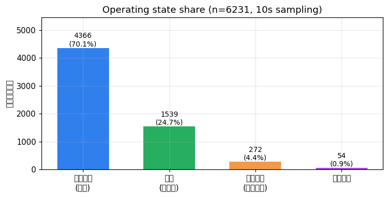
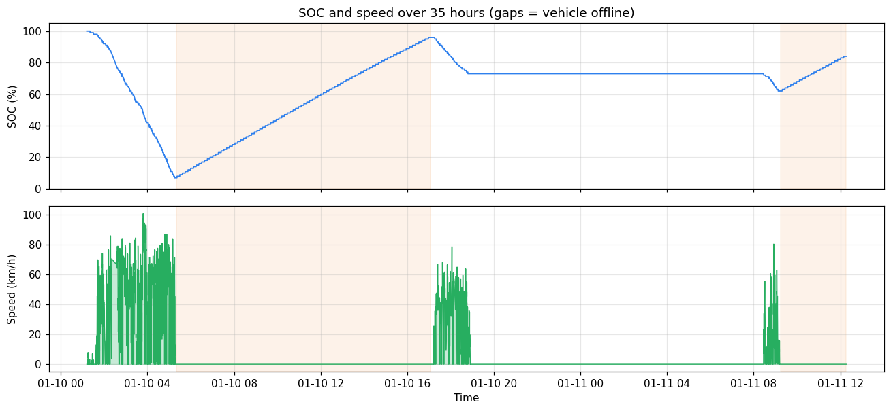
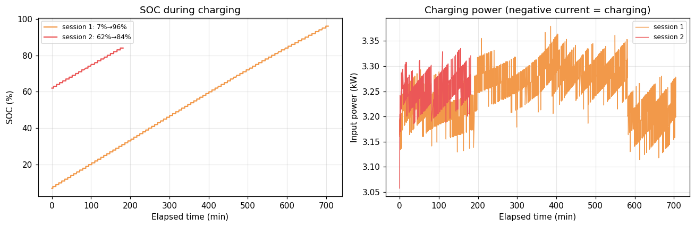
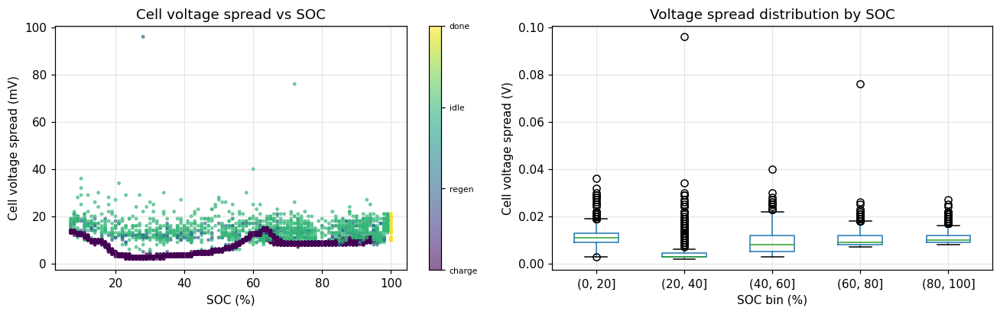

# SHEVDC 车辆运行数据分析

> **一句话结论**：这辆电动车在 35 小时的记录里行驶 **214 km**、耗电 **45.96 kWh**（约 **21.5 kWh/100km**），完成 **2 次交流慢充**（共充入 37.58 kWh，平均功率 3.25 kW）。电池一致性良好——单体电压极差中位数仅 **9 mV**（最大 96 mV），温度 **5–13 °C**、最大温差 2 °C。


📓 完整分析过程：[`notebooks/01_SHEVDC车辆运行数据分析.ipynb`](./notebooks/01_SHEVDC车辆运行数据分析.ipynb)（在 GitHub 上点开即可看到全部输出与图表）

---

## 1. 项目背景与研究问题

车联网平台会按国标 **GB/T 32960** 以 10 秒级频率上报车辆运行数据（车速、总电压电流、SOC、单体电压、温度等）。这类原始数据本身没有结论，必须经过清洗、工况识别和能量积分，才能回答业务问题。

我把它拆成四个递进的问题：

| 编号 | 研究问题 | 方法 |
|------|----------|------|
| Q1 | 数据质量如何？能直接分析吗？ | 采样间隔、覆盖率、缺口统计 |
| Q2 | 这段时间车辆在干什么？ | 车辆状态 × 充电状态交叉分析、速度分布 |
| Q3 | 充电行为是什么样的？ | 识别充电会话、充电功率与 SOC 曲线 |
| Q4 | 电池健康和能耗如何？ | 单体电压极差、温度、能量积分（电压 × 电流 × 时间） |

## 2. 数据

- **来源**：SHEVDC 平台导出的单车运行记录（`SHEVDC_OV6N7709.csv`）
- **文件**：`data/raw/SHEVDC_OV6N7709.csv`（约 640 KB，**已随仓库提交**，clone 下来即可直接复现）
- **规模**：6,231 行 × 24 列，10 秒采样
- **时间范围**：2019-01-10 01:12 — 2019-01-11 12:16（约 35.1 小时）

| 字段 | 含义 |
|------|------|
| `vehiclestatus` | 车辆状态：1=启动，2=熄火 |
| `chargestatus` | 充电状态：1=停车充电，2=行驶充电（能量回收），3=未充电，4=充电完成 |
| `speed` | 车速（km/h） |
| `sumvoltage` / `sumcurrent` | 总电压（V）/ 总电流（A，正=放电，负=充电） |
| `soc` | 剩余电量（%） |
| `max/min_cell_volt` | 最高/最低单体电压（V） |
| `max/min_temp` | 最高/最低温度（°C） |
| `summileage` | 累计里程（km） |

**数据局限（必写）**：
- 覆盖率只有 **49.3%**（6,231 / 12,626 条理论 10 秒记录），共 **106 段**超过 60 秒的缺口，最长一段 **13.5 小时**——数据只在"用车 / 充电"时上报，**不是 24 小时连续监测**；
- `summileage` 有 **4,263 行（68.4%）是字符串 `"ffill"`**（上游导出脚本把 `fillna` 的方法名写进了数据），有效数值仅 1,968 行，并存在 4 处里程跳变（+3/+17/+2/+3 km）。notebook 用数值转换后取有效值计算里程增量（缺失段是里程停滞的平段，不影响极差）；正式清洗应做前向填充，详见 [`docs/WorkBuddy分析记录.md`](./docs/WorkBuddy分析记录.md)；
- 单车、1.5 天，样本极小，不能代表车队或季节规律；
- `insulationresistance` 单位口径未确认，本次**未用于安全结论**。

> ✅ 原始数据约 640 KB，已随仓库提交，`git clone` 即可完整复现所有图表与结论。字段说明见 [`data/README.md`](./data/README.md)。

## 3. 分析流程

notebook 四步对应四个问题：

| 步骤 | 内容 | 关键产出 |
|------|------|----------|
| ① 数据质量 | 采样间隔分布、覆盖率、缺口统计 | 覆盖率 49.3%、106 段缺口 |
| ② 工况画像 | 状态交叉表、速度分布、SOC/车速时间线 | 4 类工况占比、214 km |
| ③ 充电行为 | 充电会话识别、SOC-功率曲线 | 2 次慢充、3.25 kW、37.58 kWh |
| ④ 电池与能耗 | 单体电压极差、温度、能量积分 | 极差 9 mV、21.5 kWh/100km |

### 数据清洗与预处理链路（`src/`）

WorkBuddy 阶段的清洗脚本一并入库，可从原始数据完整复现"清洗 → 预处理"，路径已改为仓库内相对路径：

| 脚本 | 输入 | 输出 |
|------|------|------|
| `src/clean_data.py` | `data/raw/SHEVDC_OV6N7709.csv` | `data/processed/SHEVDC_清洗后数据.csv`、`异常处理记录.csv` |
| `src/convert_time.py` | 清洗后数据 | `SHEVDC_时间戳转换.csv`（8 个标准时间字段，按 UTC+8 处理） |
| `src/preprocess.py` | 清洗后数据 | `SHEVDC_预处理后数据.csv`（30 列，含 5 个衍生特征 + `is_outlier`）、`异常值清单.csv`、`描述性统计表.csv` |

```bash
cd project-02-shevd
python src/clean_data.py
python src/preprocess.py
```

**清洗规则**（人工设定，不是自动拍的）：缺失值只在**能唯一推算**时补齐并记录依据；无法确认的进异常清单、不参与汇总；数值异常不删改、只登记；完全重复记录保留一条。清洗全过程见 [`docs/完整数据分析报告.md`](./docs/完整数据分析报告.md) 与 [`docs/数据清洗报告.md`](./docs/数据清洗报告.md)。

## 4. 主要发现

**① 工况画像**：6,231 条记录里，停车充电 **4,366 条（70.1%）**、未充电行驶 **1,539 条（24.7%）**、行驶充电/能量回收 **272 条（4.4%）**、充电完成 54 条（0.9%）。实际行驶时长约 **3.73 小时**、日均行驶里程 214 km（1.46 天）。

**② 行驶特征**：行驶中平均车速 **45.2 km/h**，最高 **100.7 km/h**；速度 p95 为 64.4 km/h，整体属于城市 + 快速路混合工况。

**③ 充电行为**：识别到 2 次有效慢充
- 第 1 次：SOC **7% → 96%**，历时约 11.75 小时
- 第 2 次：SOC **62% → 84%**，历时约 3 小时
- 平均充电功率 **3.25 kW**，SOC 曲线接近线性、功率平稳 → 典型交流慢充（快充会出现"恒流+恒压"两段功率曲线）
- 累计充入 **37.58 kWh**

**④ 电池一致性**：单体电压极差（最高单体 − 最低单体）均值 **9.7 mV**、中位数 **9 mV**、p95 **17 mV**、最大 **96 mV**；单体电压区间 3.346–4.147 V（96 串电池包）。温度 5–13 °C，最大温差 **2 °C**——一致性良好，热管理平稳（但仅代表冬季低温场景）。

**⑤ 能耗**：行驶放电 **45.96 kWh**，折合百公里电耗 **21.5 kWh/100km**（冬季低温 + 城市工况，属正常区间）；记录起点 SOC 为 100%，因此放电量大于本次充入量是合理的。

**⑥ 数据质量结论**：直接对相邻两行做时间积分会把 13 小时的缺口算进能耗。本分析先过滤 `dt ≤ 30s`，再积分——这一步不做，能耗结论会虚高。









## 5. 方法与取舍（面试会问）

| 选择 | 为什么 | 替代方案与代价 |
|------|--------|----------------|
| 用状态字段切分工况，不用速度阈值 | `vehiclestatus` / `chargestatus` 是上报的原始状态，最可靠 | 用速度>0 判行驶无法区分"熄火充电"和"怠速" |
| 能量积分只在 `dt ≤ 30s` 的行上做 | 缺口会被当成长时间用电/充电 | 直接累加会导致能耗虚高数十倍 |
| 用电压极差衡量一致性 | 单次数据无法测容量衰减，极差是可直接观测的一致性问题 | 想测衰减需要多次满充满放或长周期数据 |
| 不解读 `insulationresistance` | 单位口径未确认，安全结论不能靠猜 | 需要查阅平台/国标字段定义后再用 |
| 用 SOC 曲线判断快充/慢充 | 快充有恒流恒压特征，曲线形状可区分 | 直接看功率大小也能判断，但曲线更直观 |

## 6. 如何复现

```bash
git clone https://github.com/liuleeho3-jpg/data-analysis-portfolio.git
cd data-analysis-portfolio/project-02-shevd

# 数据已随仓库提供：data/raw/SHEVDC_OV6N7709.csv（约 640 KB）

python -m venv .venv
.venv\Scripts\activate          # Windows
pip install -r requirements.txt -i https://pypi.tuna.tsinghua.edu.cn/simple

jupyter lab
# 打开 notebooks/01_SHEVDC车辆运行数据分析.ipynb，从头运行
```

## 7. 项目结构

```
project-02-shevd/
├── README.md
├── requirements.txt
├── data/
│   ├── README.md                        # 字段说明与数据规模
│   ├── raw/
│   │   └── SHEVDC_OV6N7709.csv          # 原始数据（约 640 KB，已提交）
│   └── processed/                       # 清洗 / 预处理产物（脚本可复现）
│       ├── SHEVDC_清洗后数据.csv
│       ├── SHEVDC_预处理后数据.csv
│       ├── 异常处理记录.csv
│       ├── 异常值清单.csv
│       └── 描述性统计表.csv
├── notebooks/
│   └── 01_SHEVDC车辆运行数据分析.ipynb
├── src/
│   ├── clean_data.py                    # 清洗：ffill 补齐、异常登记
│   ├── convert_time.py                  # 时间戳转换（UTC+8）
│   └── preprocess.py                    # 特征工程 + 异常检测 + 描述统计
├── docs/
│   ├── 完整数据分析报告.md              # AI 报告原文（含复核说明）
│   ├── WorkBuddy分析记录.md             # 原始分析过程（会话记录）
│   ├── 分析记录.md                      # 复核后的过程：探查、决策、踩坑
│   ├── 数据清洗报告.md
│   ├── 数据特征分析报告.md
│   └── 数据预处理报告.md
└── images/
    ├── state_share.png
    ├── timeline_soc_speed.png
    ├── charging_curve.png
    └── cell_voltage_consistency.png
```

## 8. 局限与改进方向

- **样本**：单车、35 小时，不能代表车队规律；结论只能当"单案例剖析"；
- **缺口**：覆盖率 49.3%，最长缺口 13.5 小时，能耗/时长结论对积分区间敏感；
- **季节**：冬季低温数据，无法外推到高温、快充场景；
- **改进方向**：接入多车数据做车队级对比（能耗分布、充电习惯聚类）；按充电桩类型（快充/慢充）分类；用长周期满充数据反推电池可用容量与衰减趋势。

## 9. 参考

- GB/T 32960《电动汽车远程服务与管理系统技术规范》
- [pandas 文档](https://pandas.pydata.org/docs/)
